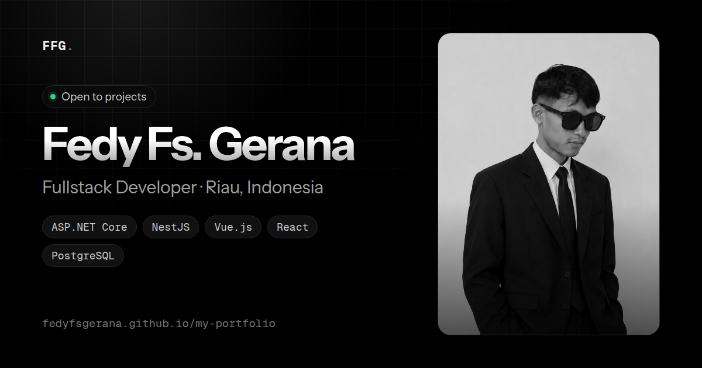

# My Portfolio

Website portofolio pribadi **Fedy Fs. Gerana**, Fullstack Developer: profil, teknologi, proyek, dan kontak dalam satu halaman.


**[Buka website](https://fedyfsgerana.github.io/my-portfolio/)**



## Daftar Isi

- [My Portfolio](#my-portfolio)
  - [Daftar Isi](#daftar-isi)
  - [Fitur](#fitur)
  - [Proyek](#proyek)
  - [Tech Stack](#tech-stack)
  - [Memulai](#memulai)
    - [Prasyarat](#prasyarat)
    - [Menjalankan secara lokal](#menjalankan-secara-lokal)
  - [Konfigurasi](#konfigurasi)
    - [EmailJS](#emailjs)
    - [Kartu proyek](#kartu-proyek)
    - [Bahasa](#bahasa)
    - [Tema dan warna](#tema-dan-warna)
    - [Foto dan CV](#foto-dan-cv)
  - [SEO dan Pratinjau Tautan](#seo-dan-pratinjau-tautan)
  - [Struktur Proyek](#struktur-proyek)
  - [Deployment](#deployment)
  - [Aksesibilitas dan Kompatibilitas](#aksesibilitas-dan-kompatibilitas)
    - [Aksesibilitas](#aksesibilitas)
    - [Browser yang didukung](#browser-yang-didukung)
  - [Lisensi](#lisensi)
  - [Pembuat](#pembuat)

## Fitur

| Fitur                        | Deskripsi                                                                                                                                                                                           |
| ---------------------------- | --------------------------------------------------------------------------------------------------------------------------------------------------------------------------------------------------- |
| Tema Sistem / Terang / Gelap | Bawaannya mengikuti pengaturan perangkat, dengan tema gelap hitam monokrom ala Vercel dan tema terang. Pilihan tersimpan di `localStorage` (`theme`) dan diterapkan tanpa kedip saat halaman dimuat |
| Dua bahasa (EN / ID)         | Bahasa Inggris menjadi bawaan, dengan pilihan Bahasa Indonesia. Pilihan tersimpan (`lang`), kamus ada di `i18n.js`                                                                                  |
| Layout bento responsif       | Hero, Tentang, Teknologi, Proyek, dan Kontak. Diuji dari lebar 320 px sampai 2560 px                                                                                                                |
| Navigasi                     | Menu atas yang menempel, menu bawah khusus ponsel, dan penanda bagian aktif saat menggulir                                                                                                          |
| Kartu proyek                 | Tombol **Coba demo** dan **GitHub** per proyek. Susunan kartu menyesuaikan jumlahnya secara otomatis                                                                                                |
| Form kontak                  | Validasi per kolom, status mengirim, pesan sukses atau gagal, dan pengiriman lewat EmailJS                                                                                                          |
| Salin email                  | Satu klik, dengan konfirmasi                                                                                                                                                                        |
| Efek sorot kursor            | Hanya aktif saat _hover_ pada perangkat dengan kursor                                                                                                                                               |
| Pratinjau tautan dan SEO     | Meta Open Graph, Twitter Card, URL kanonis, dan data terstruktur JSON-LD (`Person`) di `index.html`                                                                                                 |

## Proyek

Proyek yang ditampilkan di website ini, masing-masing dengan demo interaktif dan kode sumber publik:

| Proyek               | Deskripsi                                                                                                           | Stack                                    | Tautan                                                                                                                        |
| -------------------- | ------------------------------------------------------------------------------------------------------------------- | ---------------------------------------- | ----------------------------------------------------------------------------------------------------------------------------- |
| SSO Launcher         | Portal login tunggal (SSO) dan peluncur aplikasi dengan akses berbasis grup, sesi lintas aplikasi, dan audit trail  | .NET 10, Next.js, TypeScript, PostgreSQL | [Demo](https://fedyfsgerana.github.io/sso-launcher/) · [GitHub](https://github.com/fedyfsgerana/sso-launcher)                 |
| Meeting Room Booking | Pemesanan ruang meeting dengan persetujuan bertingkat, pengecekan kesiapan ruang, monitoring, dan riwayat aktivitas | Next.js, React, TypeScript, PostgreSQL   | [Demo](https://fedyfsgerana.github.io/meeting-room-booking/) · [GitHub](https://github.com/fedyfsgerana/meeting-room-booking) |

## Tech Stack

| Lapisan  | Teknologi                                                       | Catatan                                                   |
| -------- | --------------------------------------------------------------- | --------------------------------------------------------- |
| Struktur | HTML5                                                           | Semantik: `header`, `main`, `section`, `figure`, `footer` |
| Gaya     | CSS3                                                            | Variabel CSS, `grid`, `color-mix()`, tanpa preprocessor   |
| Perilaku | JavaScript (vanilla)                                            | Tanpa framework dan pustaka tambahan                      |
| Font     | [Geist](https://fonts.google.com/specimen/Geist) dan Geist Mono | Dari Google Fonts, dengan font sistem sebagai cadangan    |
| Form     | [EmailJS](https://www.emailjs.com/) Browser SDK v4              | Dimuat dari CDN jsDelivr                                  |

Tidak ada dependensi npm dan tidak ada proses build. Layanan luar yang dipakai hanya **Google Fonts** dan **EmailJS**.

## Memulai

### Prasyarat

- Browser modern
- Opsional: Python 3 atau Node.js untuk server lokal, supaya perilakunya sama dengan saat dipublikasikan (misalnya batas domain EmailJS)

### Menjalankan secara lokal

1. Clone repository.

   ```bash
   git clone https://github.com/fedyfsgerana/my-portfolio.git
   cd my-portfolio
   ```

2. Jalankan server lokal, pilih salah satu.

   ```bash
   python -m http.server 8000
   ```

   ```bash
   npx serve .
   ```

3. Buka `http://localhost:8000`.

Membuka `index.html` langsung dari folder juga bisa, tetapi form kontak mungkin ditolak EmailJS karena alamatnya bukan domain yang diizinkan.

## Konfigurasi

### EmailJS

Diatur di bagian atas `script.js`:

```js
var EMAILJS = { publicKey: "...", service: "...", template: "..." };
```

Template EmailJS membaca empat variabel. Atribut `name` pada form **tidak boleh diubah** kecuali template ikut diubah.

| Variabel  | Sumber                                                     |
| --------- | ---------------------------------------------------------- |
| `name`    | Kolom Nama                                                 |
| `email`   | Kolom Email                                                |
| `message` | Kolom Pesan                                                |
| `subject` | Input tersembunyi, nilainya "Pesan dari website portfolio" |

> **Catatan:** Public key memang aman berada di frontend. Atur **allowed origins** di dashboard EmailJS supaya form tidak disalahgunakan pihak lain.

### Kartu proyek

Kartu proyek ada di `index.html`, di dalam `<div class="pgrid2">` pada `<section id="proyek">`. Untuk menambah proyek, salin satu blok `<article class="card spot"> ... </article>`, lalu ubah judul, deskripsi, chip stack, tahun, dan tautannya.

Semua kartu berukuran sama. Grid menyesuaikan lebar layar secara otomatis: tiga kolom di desktop, dua kolom di tablet, dan satu kolom di ponsel.

Chip teknologi di kartu proyek memakai ikon dan warna resmi lewat atribut `data-tech`, misalnya `<li data-tech="react"><svg class="ti" viewBox="0 0 24 24" aria-hidden="true"><use href="#t-react" /></svg>React</li>`. Teknologi yang tersedia: `dotnet`, `nextjs`, `typescript`, `postgresql`, `react`, `nestjs`, `nuxt`, `vue`. Ikonnya ada di sprite SVG di awal `<body>`, dan warnanya diatur di `styles.css`. Chip tanpa `data-tech` tampil polos.

Kalau kartu disalin lengkap dengan ilustrasi `<svg>`, ubah `id` gradient-nya supaya unik, atau ganti ilustrasi dengan gambar.

Tautan diisi lewat `href` pada tombol di dalam kartu:

```html
<a
  class="plink"
  data-kind="preview"
  href="https://fedyfsgerana.github.io/nama-repo/"
  >Coba demo</a
>
<a
  class="plink"
  data-kind="repo"
  href="https://github.com/fedyfsgerana/nama-repo"
  >GitHub</a
>
```

| Kondisi `href` | Perilaku tombol                    |
| -------------- | ---------------------------------- |
| Terisi         | Aktif dan terbuka di tab baru      |
| Kosong         | Tampil redup dan tidak bisa diklik |

Untuk menyembunyikan tombol yang kosong sepenuhnya, tambahkan `data-show-empty="false"` pada `<section id="proyek">`. Kalau kedua tombol kosong, baris tombolnya ikut hilang.

Ilustrasi kartu bisa diganti tangkapan layar:

```html
<div class="art">
  
</div>
```

> **Catatan:** Untuk aplikasi internal perusahaan, jangan tampilkan kode atau data asli. Pakai tangkapan layar dengan data yang disamarkan, dan biarkan tautan GitHub kosong.

### Bahasa

Teks Indonesia ada di `index.html`, terjemahan Inggrisnya di `i18n.js`:

```js
"Teks Indonesia persis seperti di HTML": "English translation",
```

Kunci harus sama persis dengan teks di HTML. Teks yang tidak ada di kamus tampil apa adanya di kedua bahasa.

### Tema dan warna

Tema terang memakai warna aksen `--c` dan `--c-strong` di `styles.css`, yang didefinisikan di blok `:root`. Tema gelap memakai palet tersendiri yang didefinisikan di akhir `styles.css`, dua kali dengan isi yang sama: pada `:root[data-theme="dark"]` dan pada blok `@media (prefers-color-scheme: dark)`. Kalau mengubah warna tema gelap, ubah di keduanya.

| Variabel            | Nilai                 | Fungsi                                         |
| ------------------- | --------------------- | ---------------------------------------------- |
| `--brand`           | `#2E2A8C`             | Warna dasar indigo untuk cahaya dan grid latar |
| `--card`            | `#08080D`             | Latar kartu dan panel                          |
| `--card-glow`       | `#22204A`             | Cahaya indigo di pojok kanan atas kartu        |
| `--chip`            | `#171717`             | Latar pil dan chip                             |
| `--line-strong`     | `#3A3C4E`             | Border chip, tombol, dan bingkai foto          |
| `--ink` / `--muted` | `#ECEEF7` / `#A2A5B8` | Teks utama dan teks sekunder                   |

Cahaya indigo dan grid di latar halaman hanya tampil di tema gelap.

### Foto dan CV

| Berkas                    | Ketentuan                                                                                               |
| ------------------------- | ------------------------------------------------------------------------------------------------------- |
| `Fedy.webp`               | Rasio 4:5, sekitar 800 x 1000 piksel. Tampil hitam-putih di tema terang dan berwarna asli di tema gelap |
| `CV. Fedy Fs. Gerana.pdf` | Ganti dengan berkas baru bernama sama                                                                   |

## SEO dan Pratinjau Tautan

| Elemen                         | Keterangan                                                                                                                                                                       |
| ------------------------------ | -------------------------------------------------------------------------------------------------------------------------------------------------------------------------------- |
| Meta tag di `<head>`           | `description`, Open Graph, Twitter Card, dan `canonical` di `index.html`                                                                                                         |
| `og-image.png`                 | Gambar pratinjau 1200 x 630 piksel untuk WhatsApp, LinkedIn, dan X. Ganti dengan berkas baru bernama sama, lalu unggah juga di **Settings** → **Social preview** pada repository |
| JSON-LD                        | Data terstruktur `Person` di `index.html` (nama, jabatan, URL, email, GitHub)                                                                                                    |
| `robots.txt` dan `sitemap.xml` | Untuk _project page_ GitHub Pages, crawler hanya membaca `robots.txt` di akar domain. Daftarkan `sitemap.xml` secara manual di Google Search Console                             |

Kalau alamat situs berubah, perbarui URL di `canonical`, `og:url`, `og:image`, `twitter:image`, JSON-LD, `robots.txt`, dan `sitemap.xml`. Uji pratinjau tautan dengan [opengraph.xyz](https://www.opengraph.xyz/) atau LinkedIn Post Inspector setelah situs dipublikasikan.

## Struktur Proyek

```text
my-portfolio/
├── index.html                 # Struktur dan seluruh teks (bahasa Indonesia)
├── styles.css                 # Seluruh gaya; token warna di bagian atas
├── script.js                  # Tema, bahasa, salin email, form EmailJS, tautan proyek
├── i18n.js                    # Kamus terjemahan ID → EN
├── Fedy.webp                  # Foto profil
├── CV. Fedy Fs. Gerana.pdf    # CV yang diunduh dari halaman
├── favicon.svg                # Ikon tab (vektor)
├── favicon-32.png
├── apple-touch-icon.png
├── og-image.png               # Gambar pratinjau tautan (1200 x 630)
├── robots.txt
├── sitemap.xml
├── LICENSE
├── .gitignore
└── README.md
```

## Deployment

Situs ini statis, jadi semua hosting statis bisa dipakai. Tidak ada perintah build, dan folder yang dipublikasikan adalah akar repository.

| Layanan          | Langkah singkat                                                          |
| ---------------- | ------------------------------------------------------------------------ |
| GitHub Pages     | **Settings** → **Pages** → _Deploy from a branch_ → `main` / `(root)`    |
| Netlify          | Hubungkan repository, kosongkan _build command_, _publish directory_ `.` |
| Vercel           | Impor repository, _Framework Preset_ **Other**, tanpa _build command_    |
| Cloudflare Pages | Hubungkan repository, kosongkan _build command_, _output directory_ `/`  |

Setelah dipublikasikan, tambahkan domain situs ke **allowed origins** di dashboard EmailJS, dan perbarui URL di meta tag jika domainnya berbeda dari `fedyfsgerana.github.io`.

## Aksesibilitas dan Kompatibilitas

### Aksesibilitas

| Aspek             | Penerapan                                                                                 |
| ----------------- | ----------------------------------------------------------------------------------------- |
| Navigasi keyboard | Tautan "Lewati ke konten" dan indikator fokus yang jelas pada semua kontrol               |
| Form              | Pesan galat terhubung ke kolomnya (`aria-describedby`) dan tidak hanya mengandalkan warna |
| Ponsel            | Area sentuh minimal 44 px                                                                 |
| Gerakan           | Animasi dikurangi otomatis untuk pengguna dengan pengaturan _reduced motion_              |
| Kontras           | Pasangan warna utama sudah diperiksa terhadap WCAG AA di tema terang dan gelap            |

### Browser yang didukung

| Browser      | Versi minimum |
| ------------ | ------------- |
| Chrome, Edge | 111+          |
| Safari       | 16.4+         |
| Firefox      | 121+          |

Browser yang lebih lama tetap menampilkan konten, tetapi sebagian aksen visual (misalnya warna turunan dan efek kaca) bisa tidak muncul.

## Lisensi

Proyek ini adalah portofolio pribadi dan **tidak dilisensikan untuk digunakan ulang**. Seluruh kode, desain, foto, dan konten adalah milik Fedy Fs. Gerana. © 2026 Fedy Fs. Gerana. All rights reserved. Lihat berkas [LICENSE](LICENSE).

## Pembuat

**Fedy Fs. Gerana** — Fullstack Developer

- Email: [fedfg30@gmail.com](mailto:fedfg30@gmail.com)
- GitHub: [@fedyfsgerana](https://github.com/fedyfsgerana)
